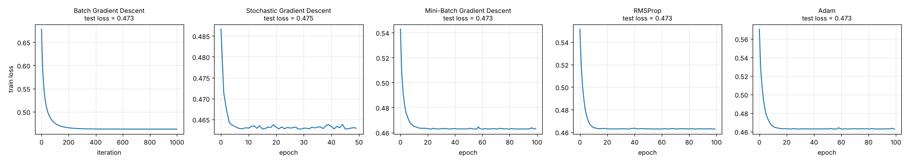

# Logistic Regression (Binary Classification) with 5 Optimizers

Predicting whether a patient has diabetes using **logistic regression**, trained with five optimization
algorithms implemented **from scratch with NumPy** (no scikit-learn).

## Dataset
[Pima Indians Diabetes (CSV)](https://www.kaggle.com/datasets/kumargh/pimaindiansdiabetescsv) from Kaggle.

| Property | Value |
|---|---|
| Samples | 768 patients |
| Features | 8 (Pregnancies, Glucose, BloodPressure, SkinThickness, Insulin, BMI, DiabetesPedigreeFunction, Age) |
| Target | `Outcome` (last column, the file has no header): 1 = diabetes, 0 = no diabetes |
| Classes | 500 negative / 268 positive |

## Repository structure
```
├── data/
│   └── pima-indians-diabetes.csv
├── notebooks/
│   ├── 1_gradient_descent.ipynb   # Batch Gradient Descent
│   ├── 2_sgd.ipynb                # Stochastic Gradient Descent
│   ├── 3_mini_batch_gd.ipynb      # Mini-Batch Gradient Descent
│   ├── 4_rmsprop.ipynb            # RMSProp
│   └── 5_adam.ipynb               # Adam
├── images/
│   └── loss_comparison.png
├── requirements.txt
└── README.md
```

## Method
1. **Cleaning:** zeros in Glucose, BloodPressure, SkinThickness, Insulin and BMI are missing values, replaced with the median of the training data
2. **Preprocessing:** 80/20 train/test split → standardization (fit on train only) → bias column
3. **Model:** `p = sigmoid(θ · x)`, predict 1 if `p ≥ 0.5`
4. **Loss:** binary cross-entropy, gradient `∇J = (1/m) · Xᵀ(p − y)`
5. **Metrics:** Accuracy, Precision, Recall, F1 (calculated from the confusion matrix)

## Results (test set, 154 patients)

| Optimizer | Loss | Accuracy | Precision | Recall | F1 |
|---|---|---|---|---|---|
| Batch GD | 0.473 | 0.760 | 0.756 | 0.534 | 0.626 |
| SGD | 0.475 | 0.753 | 0.750 | 0.517 | 0.612 |
| Mini-Batch GD | 0.473 | 0.747 | 0.732 | 0.517 | 0.606 |
| RMSProp | 0.473 | 0.747 | 0.732 | 0.517 | 0.606 |
| Adam | 0.473 | 0.747 | 0.744 | 0.500 | 0.598 |



All five optimizers reach almost the same loss (~0.47) and accuracy (~75%).
Recall is lower than precision: the model misses some diabetic patients, because the data has fewer positive cases (35%).

## How to run
```bash
pip install -r requirements.txt
jupyter notebook notebooks/
```
